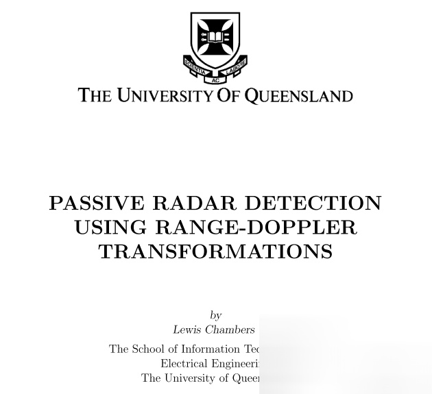
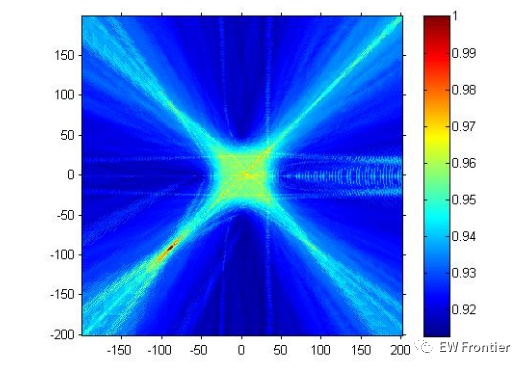
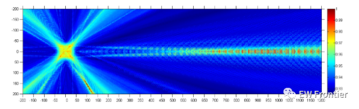
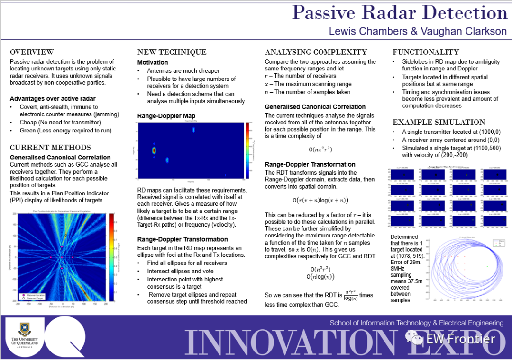

# Passive Radar Detection Based on Range-Doppler Transformation for an Unpowered Radar [Attached with documents and MATLAB code]

Abstract:
This paper investigates the problem of target detection in passive multi-base radar. It reviews the theoretical and developmental history of passive radar. The state-of-the-art solutions and analyses are presented, along with the implementation details of some existing detection algorithms. A novel distance-Doppler transform method is proposed. This method relies on a large number of radar receivers and processes targets in the range-Doppler domain. These targets are then transformed into the spatial domain, resulting in many ellipses that are elliptically deformed to determine the position of the target. The algorithm has advantages such as high accuracy, robustness against synchronization errors, and low time complexity.
Chapter 1 Introduction:
1.1 Passive Radar:
Passive radar (or passive coherent localization) detection is the problem of locating unknown targets within an interest area using only static radar receiver arrays. The objective is to use several spaced-apart radar receivers to determine the position of the target object. The challenge lies in the fact that receivers do not broadcast effective signals, so they must use already penetrated air signals, which are known as opportunity lights. Since these signals are not generated by the receivers, they are pre-known and must be distinguished from the noise and reflected signals received by the radar to determine the position of the target within the interest area.
Passive radar has many advantages over active radar. Firstly, passive radar systems consist solely of receivers, so initial costs are lower since there is no need for an emitter. Secondly, many passive radar schemes can be implemented with only static or non-directional receivers, so receivers do not need to be expensive. Thirdly, as mentioned above, many illumination sources are at VHF and UHF frequencies, where the stealth treatment of targets may not be very effective [2^]. Finally, and most importantly, passive radar allows for covert surveillance of a region because since there is no emitter, it cannot be detected. This means that passive radar can have various applications in military environments that require low cost, concealed radar systems.
No-power radar has a long history and has broad prospects in both military and civilian fields. The emergence of suitable signal processing technologies and the diffusion of high-bandwidth, high-signal-strength commercial transmissions have led no-power radar to the forefront of the radar community. No-power radar is a powerful radar technology due to its stealthiness and camouflage capabilities.
1.2 Definition and scope of the paper
This paper will study some methods currently used to solve the detection problems of no-power radar under single-site emission and multi-site reception scenarios. It will analyze the effectiveness and practicality of extending these methods to very large-scale deployments. It will also seek a new method that surpasses current technological levels for large-scale utilization.
2 Related Work
Many authors have proposed different methods to solve the problem of distinguishing targets' speed and position using no-power radar systems. All system models consist of at least one passive receiver (represented as Rx), at least one non-cooperative transmitter or opportunistic emitter (represented as Tx), and at least one stationary or moving target. Although these factors remain unchanged across different methods, many choices can be made when deriving models. These include:
● Single receiver or multiple receivers
● Use of a single illuminator or multi-band/channel illuminator
● Known versus unknown location of the transmitter
● Known versus unknown noise variance
● Methods for calculating position include:
o Correlation between each Tx-Rx pair used for calculation
o Correlation between each Rx-Rx pair used for calculation
o Combination of both
Although these are not the only considerations when designing a no-power radar system, they are the most common factors adopted when employing no-power methods. The greatest difference among many technologies lies in the algorithms used for detection and tracking of target objects.
3 Current work and recommendations
I have started analyzing and reconstructing the first paper of interest, "Generalized Canonical Correlation Analysis for No-Power Multi-Base Station Radar Detection" [10]. Using the very preliminary results of GCCA, some inaccurate simulations have been completed with very positive results so far.
The simulation scenario is as follows:
1. Setup a directional receiver at the origin and at each of the four cardinal directions (north, south, east, west) from 50 m away from the origin.
2. Set up a single-frequency transmitter 1000 m to the east of the origin.
3. Simulate targets at any given position. Based on these constraints, signals are generated by the transmitter and broadcasted to the Rx points, allowing each Rx to receive both the line-of-sight (LOS) signal and the reflected signal from the target, both with appropriate time delays. At this point, there is no consideration for signal attenuation in this model, so the received signals are at 100% of their full broadcast signal strength throughout their entire paths. This is an inaccurate representation and will be corrected in future simulations. Another inaccuracy here is that the simulated signals are purely real, which will be replaced with complex baseband signals in future simulations. No signal noise is added to this scenario to match the real-world sampling and interference in the real world. The processing is completed in a MATLAB file called signal_gen.m, which will appear in Appendix A. This function outputs the signals received by each Rx from the same time reference.
Then, these pieces of information are input into a different function, target_detect.m (see Appendix B), which attempts the processing described in this paper. This function determines the maximum eigenvalue of the Gram matrix G based on the GLRT determined by the GLRT in this paper. At this stage, the function only processes the spatial component without trying to calculate Doppler-distance calculations, and it only considers the time difference between Rx's, not Tx's. It also does not attempt to remove the LOS signal from the received signal at each position. The function outputs a planned position indicator (PPI) plot, which is then processed and drawn by the parent function test_canon.m (Appendix C) to produce acceptable output formats. The results of detecting a single target at (-100, -100) using five receivers and the GCCA method are shown in Figure 1.
It can be seen that the analysis is correctly positioned to detect our target. Although these results are not very strong or insightful, they do indeed show progress in this topic and are a good start for the topic. One thing to note is how Tx signals affect the results shown in Figure 2. As discussed in this article, processing to remove LOS signals can be used to remove such interference from the results.
Figure 2: PPI plot of detecting a single target at (100, -150) using 5 receivers, showing the impact of the transmitter on the results
4 Project Plan
The project will be divided into two parts: the review and preparatory work part, and the new technology and method part. By using this approach, I will complete previous work before attempting to extend some new technologies. The first half of the project will include reproducing and re-creating the results from previously published papers. This will involve simulation results from at least 3 papers with different methods to solve the problem. This will provide a solid practical background for current literature by implementing the proposed solutions and allow me to gain deeper insights into challenges through actual coding of solutions. Then, I will compare these different methods based on their efficiency, ease of implementation, and correctness (how well they perform).
The latter half of the project will focus on developing new technologies for passive radar detection. There will be two main focuses. First, a new passive radar detection scheme will be developed. The development process of signal models and detector algorithms will be detailed. Then, the solution will be implemented in MATLAB and compared with previous methods. The second focus will be improving the efficiency of the algorithm, aiming to make real-time calculations possible in the system. This can be achieved in various ways, and I will use techniques involving computational efficiency, algorithm modifications (by approximating certain values of interest or implementing more efficient algorithms for certain steps) [20].
5 MATLAB Code (Part):
%test_canon.m\n%Test Generalised canonical correllation\n%There will initially be 5 receivers spaced 50m apart located at origin\n%(0,0), (0,50), (0,-50), (-50,0), (50,0)\nposRx = [0, 0, 0, -50, 50;\n0,50,-50, 0, 0];\n%The transmitter will be located 1km East of the receivers\nposTx = [1000;0];\n%There will be one stationary target located ~141m NW of the origin Rx\nposTarg = [100; -150];\n%Sampling Frequency of 220MHz\nfreq = 220e6;\n%Will start with 1000 samples\nN = 1000;\nclc;\n%Generate the\nphi = signal_gen(posRx,posTx,posTarg,freq,N);\nxb = [-200,200];\nyb = [-200,200];\ntick = 1;\nout = target_detect2(phi, posRx, posTx, freq, xb, yb, tick);\nimshow(out);\ncolormap(jet);\nout2 = out/max(max(out));\nfigure;\nimshow(out2);\ncolormap(jet);\ncaxis([min(min(out2)) 1]);\nhold on;\nh = colorbar;\nset(h, 'ylim', [min(min(out2)) 1]);\n%Relabel the axes correctly\nttk=50;\nset(gca,'YTick',1:ttk:diff(yb)+1);\n%set(gca,'YTickLabel','200|150|100|50|0|-50|-100|-150|-200')\nset(gca,'YtickLabel',num2str(str2num(get(gca,'YTickLabel'))-1+yb(1)));\nset(gca,'XTick',1:ttk:diff(xb)+1);\n%set(gca,'XTickLabel','-200|-150|-100|-50|0|50|100|150|200')\nset(gca,'XtickLabel',num2str(str2num(get(gca,'XTickLabel'))-1+yb(1)));\n%TAKES 21.8 seconds\n  
function phi = signal_gen(posRx, posTx, posTarg, freq, N)\n%A function that generates random signal, then distributes it as well as\n%off 1 target\n%\n%ALL DISTANCES ARE IN METRES\n%\n%INPUTS:\n%\nposRx - the position of each receiver so that posRx(1,i) and posRx(2,i)\n%\nare the x- and y-positions of receiver i\n%\nposTx - the position of the transmitter so that posTx = [xpos; ypos]\n%\nposTarg - the positions of the targets so that\n%\nposTarg(:,i) = [xpos taget i; ypos target i]\n%\nfreq - The sampling frequency of the sampled signals\n%\nN - The number of samples we want generated\n%\n%OUTPUTS:\n%\nphi - An array of inputs from receivers in the form [X1, X2,...,Xm]\n%\nwhere Xi is a column array of values. Xi can be recovered by\n%\nXi = phi(:,i)\n%CONSTANTS\n%C = Speed of light (in m/s)\nC = 299792458;\n%alpha = Signal degredation (/m or m^-1) Range: 0-1;\n%0 is full signal degredation and 1 is none\n%alpha = 1;\n%DERIVED CONSTANTS\n%m = number of receivers\nm = size(posRx,2);\n%dt = time between samples (seconds)\ndt = 1/freq;\n%DTxTarg = Distance from transmitter to target\nDTxTarg = norm(posTx-posTarg);\n%DTargRx = Array of distances where D(i) = distance from target to Rxi\nDTargRx = zeros(m,1);\nfor rec = 1:m\nDTargRx(rec) = norm(posTarg-posRx(:,rec));\nend\n%DTxRx = Array of distances where D(i) = distance from Tx to Rxi\nDTxRx = zeros(m,1);\nfor rec = 1:m\nDTxRx(rec) = norm(posTx-posRx(:,rec));\nend\n%Calculate maximum travel time of the signal and the equivelant number of\n%samples that it would be delaed by\nMAX_DIST = max(DTargRx) + DTxTarg;\nMAX_TIME = MAX_DIST / C;\nMAX_SAMP = round(MAX_TIME / dt)+1;\n%Number of generated samples\nNgen = N+MAX_SAMP;\nS = rand(Ngen,1);\n%Initialize phi (will truncate at end)\nphi = zeros(Ngen,m);\n% Give each receiver the target signal\nfor rec = 1:m\nDIST = DTxTarg + DTargRx(rec);\nTIME = DIST / C;\nSAMP = round(TIME / dt);\nphi(SAMP:end,rec) = S(1:Ngen-SAMP+1);\nend\n%Give each receiver the original signal\nfor rec = 1:m\nDIST = DTxRx(rec);\nTIME = DIST / C;\nSAMP = round(TIME / dt);\nphi(SAMP:end,rec) = phi(SAMP:end,rec)+S(1:Ngen-SAMP+1);\nend\nphi = phi(Ngen-N+1:end,:);\n  
Appendix B. MATLAB file: target_detect.m\nfunction out = target_detect(phi, posRx, posTx, freq, xb, yb, tick)\n%A function that returns array of log-likelihood for input phi\n%\n%ALL DISTANCES ARE IN METRES\n%\n%INPUTS:\n%\nphi - An array of inputs from receivers in the form [X1, X2,...,Xm]\n%\nwhere Xi is a column array of values. Xi can be recovered by\n%\nXi = phi(:,i)\n%\nposRx - the position of each receiver so that posRx(1,i) and posRx(2,i)\n%\nare the x- and y-positions of receiver i\n%\nposTx - the position of the transmitter so that posTx = [xpos; ypos]\n%\nfreq - The sampling frequency of the sampled signals\n%\n%OPTIONAL INPUTS:\n%\nxb - the x-boundary. xb = [xmin, xmax]. will iterate over this boundary\n%\nyb - the y-boundary. yb = [ymin, ymax]. will iterate over this boundary\n%\ntick - the resolution of the iteration in space\n%\n%OUTPUTS:\n%\nout - an array of dimensions [diff(yb), diff(xb)] with log likelihood\n%\nof each position being a target\n%function out\n%NOTES:\n%\n- In code all arrays are row/col == i/j == x/y\n%\n- At the end out is transposed to get in the correct orientation\n%Sort out optional inputs defaults\nif nargin < 4\nxb = [-5500,11000];\nyb = [-2000,2000];\ntick = 10;\nend\n%CONSTANTS\n%C = Speed of light (in m/s)\nC = 299792458;\n%DERIVED CONSTANTS\n%m = number of receivers\nm = size(posRx,2);\n%num_samp = number of samples of each signal taken\nnum_samp = size(phi,1);\n%dt = time between samples (seconds)\ndt = 1/freq;\n%\n%The possible xy positions to check\nx = xb(1):tick:xb(2);\ny = yb(1):tick:yb(2);\nout = zeros(numel(x),numel(y));\n%Iterate through each xy position and receiver\niindex = 0;\nfor i = x\niindex = iindex + 1;\njindex = 0;\nfor j = y\njindex = jindex+1;\n%Iterate through each receiver to get the time delay and calculate\n%the number of samples delay to put in nset - the set of sample\ndelays\nnset = zeros(m,1);\nfor rec = 1:m\n%Calculate distance along Target - Rx and time taken\n%Can ignore distance from Tx to ij as is constant for each\n%receiver and ij.\ndistRx = norm(posRx(:,rec)-[i;j]);\ntravel_time = distRx/C;\n%calculate n, number of samples delayed\nnset(rec) = round(travel_time / dt);\nend\n%time adjusted signal x'(t) and put into PHI\n%Need to set maxn\n%Shortest delay will be our starting point\nn = min(nset);\nnset = nset - n;\n%Longest delay will determine how many signals we store for each\nnmax = max(nset);\nnstore = num_samp - nmax;\n%Initialise the PHI from paper. PHI = [X1' X2' ... Xm']\n%Note: here X1' does not denote transpose\nPHI = zeros(nstore,m);\nfor rec = 1:m\n%So we can throw away the first nset samples of each signal to\n%get all signal from the same time\nnstart = nset(rec)+1;\nPHI(:,rec) = phi(nstart:nstart+nstore-1,rec);\nend\n%Here we have PHI for the position (i,j)\n%Calculate Gram Matrix G:\nG = PHI' * PHI;\nout(iindex,jindex) = max(eig(G));\nend\nend\nout = out';\nout = flipud(out);\n  
All MATLAB code is available here:

## Images

<!-- PAYMENT_BLOCK -->

## Get this dataset

- Payment link (Stripe): [Buy now](https://buy.stripe.com/3cs8yP7sY87d0vu9AB)
- Payment QR code: 

<!-- /PAYMENT_BLOCK -->
